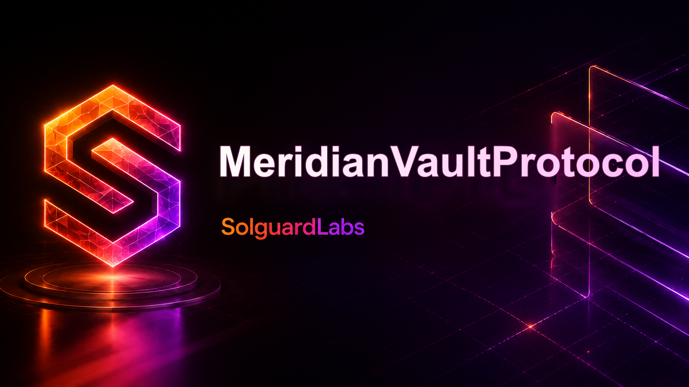

# MeridianVaultProtocol



MeridianVaultProtocol es un protocolo de vaults ERC-4626 para stablecoins que distribuye el
capital entre varias estrategias y mantiene una reserva líquida para atender retiradas. El
sistema separa la custodia de activos, la contabilidad de shares, la gestión de estrategias y
la publicación de reportes para que cada responsabilidad pueda probarse y administrarse de
forma independiente.

> Estado: implementación de referencia en desarrollo. El software no ha sido auditado y no
> debe utilizarse con fondos reales sin una revisión independiente, parámetros operativos
> adecuados y controles de despliegue.

## Características

- Interfaz de depósitos y redenciones compatible con ERC-4626.
- Activo subyacente configurable con soporte explícito para los decimales de la stablecoin.
- Asignación de deuda entre múltiples estrategias internas.
- Cola ordenada de retirada para recuperar liquidez de las estrategias.
- Reportes periódicos de rendimiento, deuda y capital disponible.
- Límites globales y por operación para depósitos, retiros y exposición por estrategia.
- Pausas y acciones de emergencia separadas de la administración ordinaria.
- Roles diferenciados para gobierno, guardianes y operadores.

## Modelo del protocolo

### Vault y shares

El vault recibe el activo subyacente y emite shares siguiendo las reglas de conversión de
ERC-4626. La contabilidad distingue la liquidez ociosa del capital asignado a estrategias y
expone vistas para previsualizar depósitos, acuñaciones, retiros y redenciones.

Las integraciones deben utilizar `previewDeposit`, `previewMint`, `previewWithdraw` y
`previewRedeem` inmediatamente antes de construir una operación. Los límites devueltos por
`maxDeposit`, `maxMint`, `maxWithdraw` y `maxRedeem` forman parte de la interfaz operativa y
pueden variar por pausas, liquidez o configuración de riesgo.

### Estrategias

Cada estrategia administra una parte acotada del activo. El vault registra su deuda, su
posición en la cola y sus límites de exposición. La incorporación, actualización y retirada
de estrategias son acciones de gobierno; la ejecución ordinaria puede delegarse a un
operador con permisos más limitados.

Una estrategia debe ofrecer una valoración coherente, ejecutar su ciclo operativo y comunicar
resultados mediante el mecanismo de reportes definido por el protocolo.

### Reportes

Los reportes sincronizan el estado observado de las estrategias con la contabilidad del
vault. Su procesamiento puede incluir ganancias, pérdidas, comisiones, devolución de deuda
y ajustes de exposición. Los despliegues deben definir una cadencia máxima de reporte y
monitorizar reportes atrasados o desviaciones extraordinarias.

### Cola de retirada

Cuando la reserva líquida no cubre una retirada, el vault consulta las estrategias según la
cola configurada. El orden permite priorizar posiciones con menor coste o mayor liquidez. Los
cambios de cola deben preservar entradas únicas y referirse únicamente a estrategias activas.

### Límites

Los límites reducen la exposición operativa y sirven como mecanismo de contención. El diseño
contempla, como mínimo:

- capacidad total del vault;
- máximo de depósito por operación o cuenta;
- máximo de retirada sujeto a liquidez disponible;
- límite de deuda por estrategia;
- pérdida máxima aceptable durante una recuperación de capital;
- antigüedad máxima permitida para un reporte.

Los valores apropiados dependen del activo, la estrategia y las condiciones del mercado; no
existen parámetros universales seguros.

## Roles

| Rol | Responsabilidad esperada |
| --- | --- |
| Administrador | Configuración inicial y transferencia controlada de permisos. |
| Gobierno | Alta de estrategias, límites, cola, comisiones y cambios de parámetros. |
| Guardián | Pausas y medidas de contención con alcance limitado. |
| Operador | Reportes, rebalanceos y mantenimiento rutinario. |

En producción se recomienda asignar gobierno a una multisig con timelock, mantener el rol de
guardián en una entidad independiente y evitar que una sola clave reúna funciones de gobierno
y operación.

## Requisitos

- [Foundry](https://book.getfoundry.sh/) con una versión compatible con Solidity 0.8.24.
- Git.
- Node.js 20 o posterior únicamente para utilidades de formato opcionales.

## Desarrollo

```bash
forge build
forge test
forge fmt --check
```

Para ejecutar la batería con más casos de fuzzing e invariantes:

```bash
FOUNDRY_PROFILE=ci forge test -vvv
```

También se proporcionan accesos equivalentes mediante npm:

```bash
npm run build
npm test
npm run coverage
```

Los scripts reproducibles ejecutan la suite corta o la validación completa:

```bash
bash scripts/tests.sh
bash scripts/ci.sh
```

En Windows se incluyen entradas nativas equivalentes:

```powershell
powershell -NoProfile -ExecutionPolicy Bypass -File scripts/tests.ps1
powershell -NoProfile -ExecutionPolicy Bypass -File scripts/ci.ps1
```

## Estructura

```text
src/
  access/       Control de acceso y permisos
  interfaces/   Interfaces públicas y de integración
  libraries/    Matemáticas y validaciones reutilizables
  oracle/       Fuentes y normalización de valoraciones
  strategies/   Adaptadores y estrategias de inversión
  token/        Activos auxiliares para desarrollo
  types/        Tipos de datos compartidos
  vault/        Contabilidad y lógica ERC-4626
tests/
  unit/          Pruebas unitarias
  integration/   Flujos entre componentes
  invariant/     Propiedades de estado
  helpers/       Utilidades de prueba
```

## Principios de integración

1. Establecer tolerancias de slippage y fechas límite en la capa que construye la transacción.
2. Comprobar los límites ERC-4626 antes de cada operación.
3. Tratar reportes, pausas y cambios de cola como eventos operativos monitorizables.
4. Monitorizar los límites operativos y confirmar cada transición antes de encadenar acciones.
5. Validar direcciones, decimales y roles en cada entorno antes de habilitar depósitos.

## Seguridad

Consulta [SECURITY.md](SECURITY.md) para comunicar asuntos de seguridad de forma privada. No
publiques información sensible en issues, discusiones o pull requests.

## Licencia

Este proyecto se distribuye bajo la licencia MIT. Consulta [LICENSE](LICENSE).
