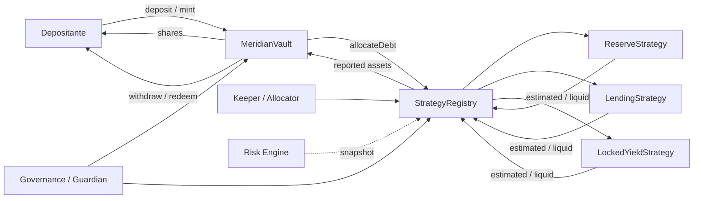
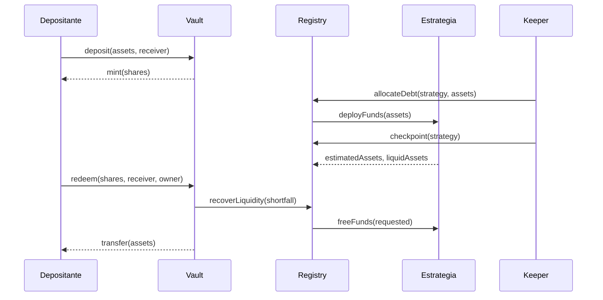
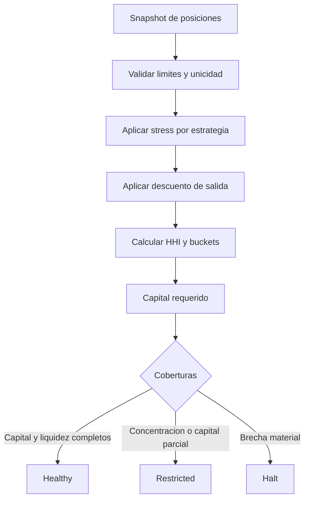
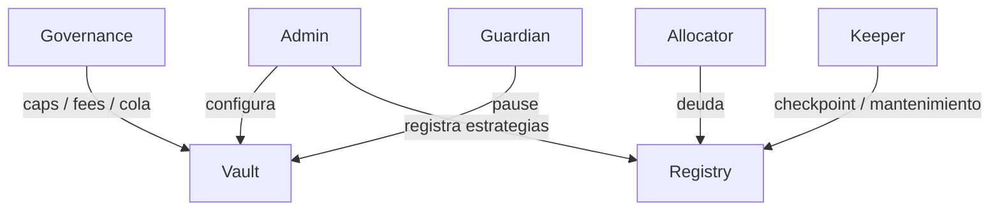

# MeridianVaultProtocol


[](https://github.com/SolguardLabs/MeridianVaultProtocol/actions/workflows/ci.yml)
[](https://github.com/SolguardLabs/MeridianVaultProtocol/actions/workflows/release-integrity.yml)
[](https://soliditylang.org/)
[](LICENSE)

MeridianVaultProtocol es una plataforma ERC-4626 para administrar tesorerias en stablecoins mediante
una reserva liquida y una cartera acotada de estrategias. El protocolo separa custodia, emision de
shares, registro de deuda, valoracion, comisiones, recuperacion de liquidez y evaluacion de riesgo.

La version `1.0.0` fija una superficie reproducible para integradores, operadores y revisores. Las
transiciones economicas se ejecutan on-chain; los procedimientos de despliegue, monitorizacion y
respuesta se describen en [`docs/`](./docs/).

## Arquitectura



El vault conserva el activo y los shares. `StrategyRegistry` mantiene la deuda, la cola de salida y
los ultimos valores reportados. Las estrategias encapsulan la interaccion con fuentes externas.
`MeridianRiskEngine` recibe snapshots de solo lectura y produce una decision operativa determinista;
no mueve fondos ni modifica el precio de los shares.

## Ciclo economico



El valor gestionado se expresa como:

```text
totalAssets = idleAssets + totalReportedAssets
shares(deposit) = assetsNet * (totalSupply + virtualShares)
                  / (totalAssets + virtualAssets)
assets(redeem) = shares * (totalAssets + virtualAssets)
                 / (totalSupply + virtualShares)
```

El redondeo favorece al vault: depositos y redenciones redondean hacia abajo; mint y withdraw
calculan el coste hacia arriba. Las comisiones se liquidan al treasury configurado y nunca se acuñan
como shares ocultos.

## Componentes

| Componente                | Responsabilidad                                       |
| ------------------------- | ----------------------------------------------------- |
| `MeridianVault`           | ERC-4626, caps, conversiones, fees y reserva liquida. |
| `StrategyRegistry`        | Catalogo, deuda, reportes, cola y recuperacion.       |
| `MeridianValuationPolicy` | Limites de variacion, liquidez y cadencia.            |
| `MeridianFeePolicy`       | Calendarios de deposito, retirada y rendimiento.      |
| `BaseStrategy`            | Ciclo comun, roles, pausas y contabilidad operativa.  |
| `MeridianRiskEngine`      | Stress, liquidez, concentracion y capital requerido.  |
| `MeridianRoles`           | Gobierno en dos pasos y permisos segregados.          |

## Modelo de riesgo

Cada posicion aporta valor estimado, liquidez inmediata, perdida de stress, descuento de salida y
bucket de correlacion. El motor calcula:

```text
stressedValue_i = estimated_i * (1 - stressLossBps_i)
exitValue_i     = liquid_i * (1 - exitDiscountBps_i)
liquidityGap    = max(withdrawalDemand - exitLiquidity, 0)
requiredCapital = stressLoss + liquidityGap
                + concentrationAddOn + capitalBuffer
```



La decision es una señal de admision para la capa operativa. No reemplaza los limites on-chain ni
autoriza automaticamente movimientos.

Consulta [modelo economico](./docs/modelo-economico.md) y
[riesgo y capital](./docs/riesgo-y-capital.md) para formulas y ejemplos.

## Inicio rapido

Requisitos:

- Foundry estable con Solidity `0.8.24`;
- Git;
- Node.js `24` para controles documentales e integridad.

```bash
git clone https://github.com/SolguardLabs/MeridianVaultProtocol.git
cd MeridianVaultProtocol
npm ci
npm run ci
```

Comandos principales:

```bash
forge build --sizes
forge test -vvv
forge fmt --check
npm run scan:public
npm run release:check
```

En Windows:

```powershell
powershell -NoProfile -ExecutionPolicy Bypass -File scripts/ci.ps1
npm.cmd run scan:public
```

## Ejemplo de evaluacion

```solidity
MeridianRiskEngine.Request memory request = MeridianRiskEngine.Request({
    idleAssets: 200_000e6,
    withdrawalDemand: 500_000e6,
    capitalReserve: 250_000e6
});

MeridianRiskEngine.Policy memory policy = MeridianRiskEngine.Policy({
    minimumLiquidityCoverageBps: 9_000,
    maximumStrategyConcentrationBps: 7_000,
    maximumBucketConcentrationBps: 7_500,
    capitalBufferBps: 500,
    restrictedCapitalCoverageBps: 9_000
});
```

Una cartera con `500.000` unidades en una estrategia locked y `300.000` en una estrategia de lending
produce, con el escenario de referencia:

| Metrica                  | Resultado |
| ------------------------ | --------: |
| Activos estimados brutos | 1.000.000 |
| Activos bajo stress      |   890.000 |
| Liquidez de salida       |   620.000 |
| Perdida de stress        |   110.000 |
| Buffer de capital        |    50.000 |
| Capital requerido        |   160.000 |
| HHI                      | 5.312 bps |
| Decision                 | `Healthy` |

## Roles y cambios



- `ADMIN_ROLE`: configuracion excepcional y reanudacion.
- `GUARDIAN_ROLE`: contencion mediante pausa.
- `ALLOCATOR_ROLE`: asignacion y recuperacion de deuda.
- `KEEPER_ROLE`: reportes y mantenimiento rutinario.

La propiedad se transfiere en dos pasos. Los cambios de parametros deben prepararse, simularse y
ejecutarse con identidades separadas.

## Garantias verificadas

La suite cubre, entre otras, estas propiedades:

- conservacion de activos durante asignacion y recuperacion;
- caps globales y por receptor;
- allowances en withdraw y redeem;
- unicidad y validez de la cola;
- segregacion de roles y pausa;
- limites de variacion y liquidez de reportes;
- aritmetica de fees y redondeos ERC-4626;
- stress, descuento de salida, HHI, buckets y decisiones de capital;
- fuzzing de depositos, redenciones y asignaciones.

## Documentacion

- [Arquitectura y limites de confianza](./docs/arquitectura.md)
- [Modelo economico](./docs/modelo-economico.md)
- [Riesgo y suficiencia de capital](./docs/riesgo-y-capital.md)
- [Operacion y observabilidad](./docs/operacion.md)
- [Integracion ERC-4626](./docs/integracion.md)
- [Politica de seguridad](./SECURITY.md)
- [Contribucion](./CONTRIBUTING.md)
- [Historial de cambios](./CHANGELOG.md)

## Versionado

Las versiones siguen SemVer. Una entrega estable requiere el mismo commit en `main`, `production` y
el tag anotado correspondiente, con CI e integridad verdes antes de publicar el release.

## Licencia

MIT. Consulta [LICENSE](./LICENSE).
