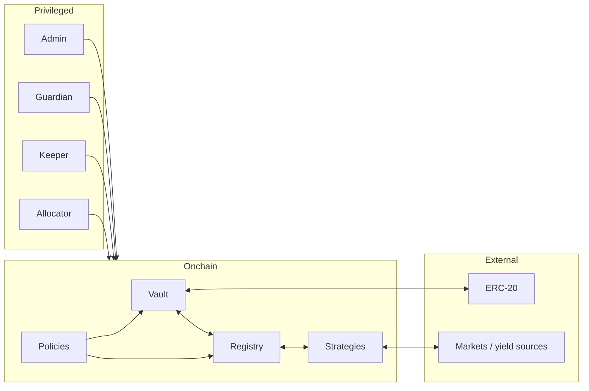
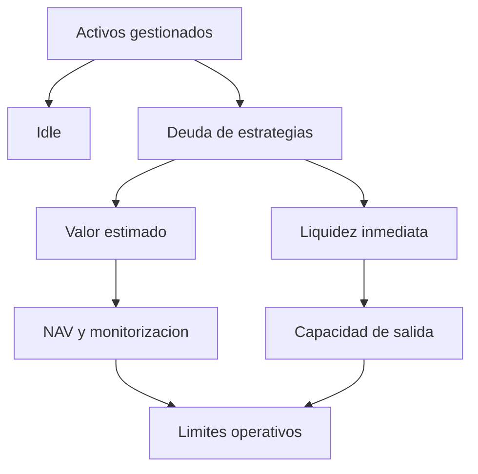
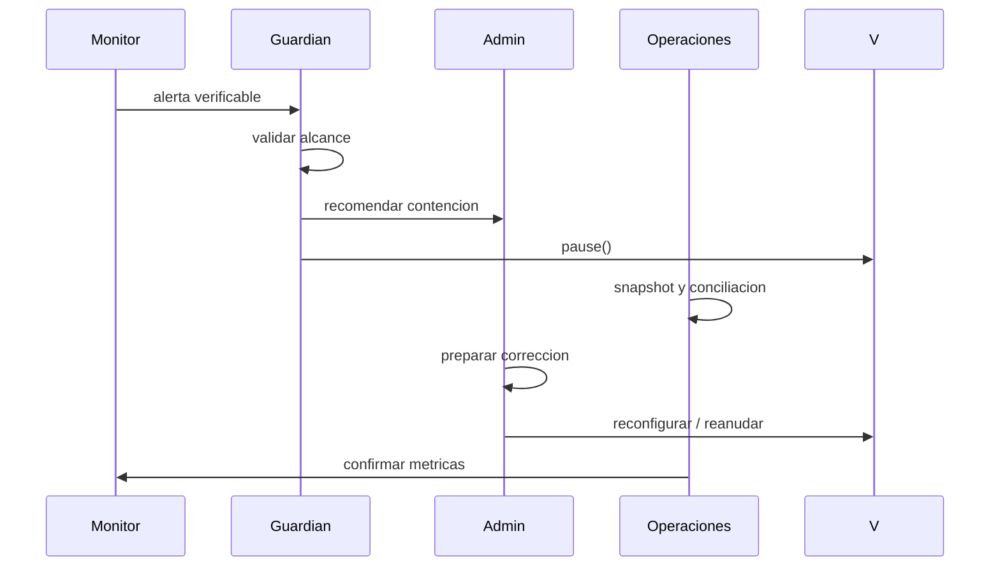

# Politica de seguridad

MeridianVaultProtocol trata la custodia, las conversiones ERC-4626, la deuda de estrategias, los
reportes y la administracion de permisos como una unica superficie de seguridad economica.

## Versiones soportadas

| Version   | Soporte      |
| --------- | ------------ |
| `1.0.x`   | Activo       |
| `< 1.0.0` | No soportado |

Los consumidores deben fijar un tag publicado y verificar el commit de la rama `production`. No se
garantiza compatibilidad para commits intermedios.

## Comunicacion privada

Informa cualquier incidencia mediante un GitHub Security Advisory privado del repositorio. No
publiques detalles sensibles en issues, discusiones, forks o pull requests.

Incluye:

- version, commit y componente afectados;
- configuracion y precondiciones;
- impacto economico y activos implicados;
- secuencia minima reproducible;
- prueba automatizada, si procede;
- propuesta de contencion o correccion;
- forma de contacto y preferencia de reconocimiento.

El equipo intentara confirmar recepcion en tres dias laborables, clasificar el informe en siete y
coordinar la correccion antes de cualquier divulgacion.

## Limites de confianza



El modelo asume:

- activo ERC-20 conforme a su interfaz y precision declarada;
- estrategias registradas tras revision tecnica y economica;
- fuentes externas con limites y pausas independientes;
- claves privilegiadas segregadas y protegidas;
- parametros revisados antes de habilitar operaciones;
- observabilidad suficiente para detectar reportes tardios y brechas de liquidez.

## Invariantes de custodia

- Una asignacion mueve activos y deuda en la misma transicion.
- La deuda individual no supera su limite configurado.
- La recuperacion registra importe recibido y perdida observada.
- Los activos transferidos al treasury corresponden a fees calculados.
- La cola contiene estrategias activas, unicas y conocidas.
- Una pausa impide nuevas entradas y las operaciones definidas por politica.
- Withdraw y redeem consumen allowance cuando caller y owner difieren.

## Invariantes economicas



- Los calculos usan los decimales del activo subyacente.
- Las conversiones respetan el sentido de redondeo de ERC-4626.
- Los shares virtuales se aplican de forma simetrica.
- Los caps se comprueban en la misma transaccion que modifica el estado.
- El valor estimado y la liquidez inmediata se monitorizan por separado.
- La suficiencia de capital se calcula sobre snapshots identificables.
- Los buckets de correlacion no sustituyen limites por estrategia.

## Controles de acceso

| Capacidad      | Identidad recomendada  | Control                          |
| -------------- | ---------------------- | -------------------------------- |
| Administracion | Multisig con timelock  | Revision y ejecucion separadas   |
| Pausa          | Guardian dedicado      | Clave de alcance reducido        |
| Asignacion     | Allocator              | Caps y limites por estrategia    |
| Reportes       | Keeper                 | Cadencia y alertas de desviacion |
| Treasury       | Multisig independiente | Conciliacion de fees             |

La propiedad se transfiere en dos pasos. La rotacion debe revocar las claves anteriores y confirmar
on-chain todas las concesiones.

## Severidad

| Nivel   | Ejemplos                                                     |
| ------- | ------------------------------------------------------------ |
| Critica | Perdida de custodia, insolvencia, acuñacion no respaldada.   |
| Alta    | Bloqueo prolongado, bypass de caps, control privilegiado.    |
| Media   | Degradacion acotada, DoS recuperable, accounting secundario. |
| Baja    | Defensa en profundidad sin impacto economico directo.        |

La severidad final considera capital expuesto, permisos requeridos, repetibilidad, detectabilidad y
capacidad de recuperacion.

## Respuesta operativa



Ante una desviacion material:

1. confirmar datos contra RPCs independientes;
2. preservar logs, bloques y configuracion;
3. detener nuevas entradas si el alcance lo exige;
4. evitar rebalanceos que destruyan evidencia;
5. cuantificar deuda, liquidez, fees y exposicion;
6. simular la contencion sobre un fork autorizado;
7. ejecutar mediante el proceso de gobierno;
8. verificar invariantes antes de reanudar.

## Validacion de releases

Cada release estable exige:

```bash
forge fmt --check
forge build --sizes
FOUNDRY_PROFILE=ci forge test -vvv
npm run scan:public
npm run release:check
```

CI ejecuta la suite en Linux y Windows. El control de integridad verifica version, documentacion,
banner, tag esperado y ausencia de material privado.

## Entornos autorizados

Las pruebas activas deben limitarse a despliegues propios, forks locales o redes para las que exista
autorizacion expresa. No interactues con contratos, cuentas o activos de terceros sin permiso
verificable.

## Exclusiones habituales

Salvo impacto adicional demostrable, no suelen priorizarse:

- preferencias de estilo o documentacion;
- dependencias de una clave ya comprometida sin escalada adicional;
- indisponibilidad exclusiva de un proveedor externo;
- recomendaciones de gas sin impacto de seguridad;
- resultados de scanners sin reproduccion tecnica.

## Preparacion de despliegue

- Verificar bytecode, constructor y direcciones.
- Confirmar decimales, caps, fees y limites de deuda.
- Ensayar pausa, recuperacion y transferencia de propiedad.
- Configurar alertas de liquidez, concentracion y reportes.
- Mantener runbooks accesibles a guardian y operaciones.
- Registrar hashes de artefactos y parametros aprobados.

Esta politica define el proceso del repositorio; cada despliegue requiere su propio analisis de
riesgo y gobierno.
