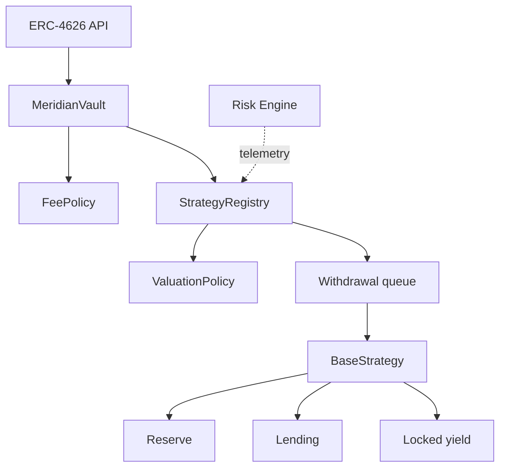
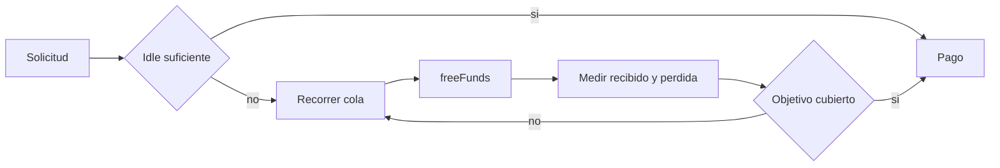

# Arquitectura y limites de confianza

## Capas

MeridianVaultProtocol divide el sistema en cuatro capas: interfaz ERC-4626, registro de estrategias,
adaptadores de capital y politicas auxiliares. Esta separacion evita que una estrategia pueda
modificar directamente shares, caps o fees.

## Propiedad del estado

| Estado                  | Propietario     | Escritura autorizada            |
| ----------------------- | --------------- | ------------------------------- |
| Shares y supply         | Vault           | deposit, mint, withdraw, redeem |
| Caps y reserva objetivo | Vault           | gobierno                        |
| Deuda y reportes        | Registry        | vault, keeper, allocator        |
| Posicion externa        | Estrategia      | operadores de estrategia        |
| Fee schedule            | FeePolicy       | administracion                  |
| Bounds de valoracion    | ValuationPolicy | administracion                  |
| Reporte de riesgo       | Sin estado      | llamada pura                    |

## Fronteras externas

Los mercados y fuentes de yield pueden pausar, redondear o limitar retiradas. El adapter traduce esa
semantica a `estimatedTotalAssets`, `liquidTotalAssets`, `deployFunds` y `freeFunds`. La capa
superior no debe suponer que una estimacion implica salida inmediata.

## Flujo de retirada

## Actualizaciones

La version 1.0.0 no incorpora proxy. Un cambio de bytecode requiere un nuevo despliegue y una
migracion gobernada. Los consumidores deben fijar interfaces y tags, no ramas mutables.
