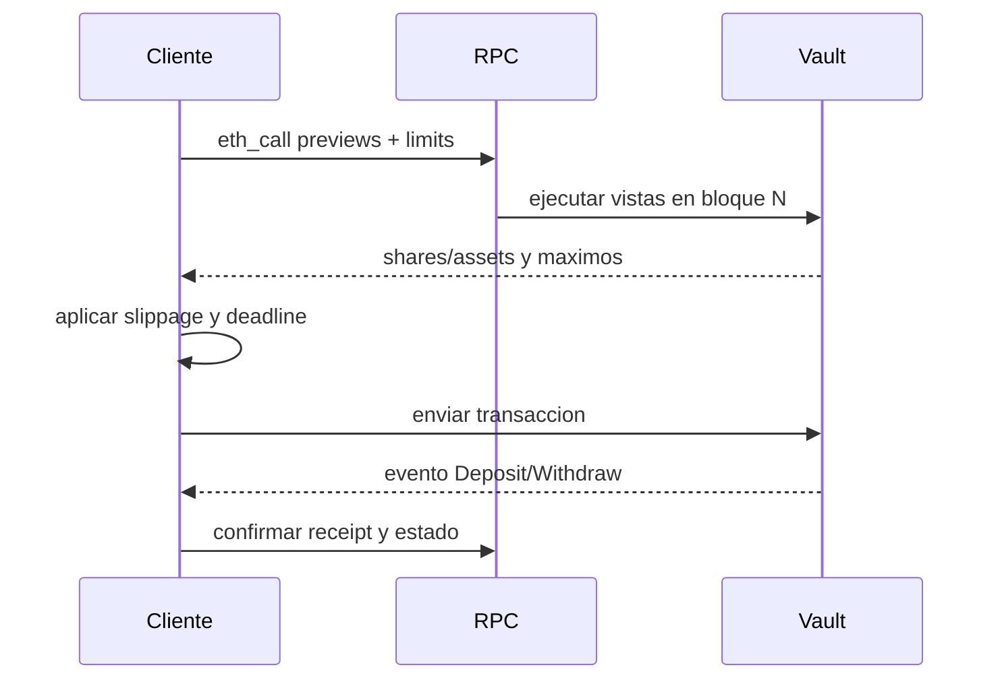

# Integracion ERC-4626

## Lecturas previas

Antes de construir una operacion consulta, en el mismo bloque:

- `asset()` y `decimals()`;
- `maxDeposit` o `maxMint`;
- `previewDeposit` o `previewMint`;
- `maxWithdraw` o `maxRedeem`;
- estado de pausa;
- deadline y limite de slippage definidos por la aplicacion.



## Deposit

```solidity
uint256 maximum = vault.maxDeposit(receiver);
uint256 expectedShares = vault.previewDeposit(assets);
require(assets <= maximum);
asset.approve(address(vault), assets);
uint256 shares = vault.deposit(assets, receiver);
require(shares >= minimumShares);
```

La comprobacion cliente no sustituye la validacion on-chain. Entre lectura y minado pueden cambiar
NAV, caps o pausa.

## Withdraw y redeem

`withdraw` fija assets y calcula shares; `redeem` fija shares y calcula assets. Si caller y owner
difieren, el owner debe haber aprobado shares suficientes. La liquidez puede reducirse entre
simulacion y ejecucion.

## Indexacion

Consume `Deposit`, `Withdraw`, eventos de deuda, reportes y cambios de roles. Reprocesa desde el
ultimo bloque finalizado ante una reorganizacion y no uses eventos aislados como sustituto de las
vistas de estado.

## Errores

- clasifica pausa y caps como estados operativos;
- no reintentes indefinidamente una falta de liquidez;
- vuelve a leer previews tras cada fallo;
- muestra assets y shares con sus precisiones correctas;
- registra chain id, bloque y calldata para soporte.
