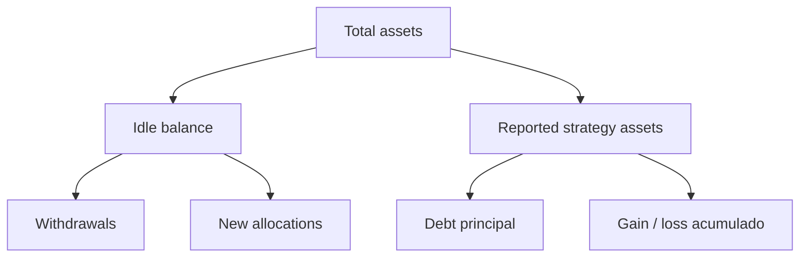

# Modelo economico

## Unidades

Los importes usan la precision del activo. Las ratios de politica usan basis points
(`10.000 = 100%`). Los shares disponen de su propia precision, ajustada mediante offsets virtuales.

## Emision y quema

```text
sharesOut = floor(assetsNet * adjustedSupply / adjustedAssets)
assetsIn  = ceil(shares * adjustedAssets / adjustedSupply)
assetsOut = floor(shares * adjustedAssets / adjustedSupply)
sharesIn  = ceil(assets * adjustedSupply / adjustedAssets)
```

`adjustedSupply` y `adjustedAssets` incluyen las constantes virtuales. Este mecanismo reduce
sensibilidad al primer deposito y mantiene direcciones de redondeo coherentes.

## Balance del vault



La deuda representa capital entregado por el vault. El reporte describe el valor observado. La
diferencia se contabiliza como ganancia o perdida y se somete a bounds de variacion.

## Fees

Para un deposito con fee `f_d`:

```text
depositFee = floor(assets * f_d / 10_000)
netAssets  = assets - depositFee
```

Para obtener un neto de retirada exacto se reconstruye el bruto con redondeo hacia arriba. Esto
impide que la precision reduzca el importe debido al treasury.

## Ejemplo

Con `1.500.000` unidades gestionadas, `1.200.000` shares y un deposito neto de `75.000`, el usuario
recibe, sin offsets materiales:

```text
75.000 * 1.200.000 / 1.500.000 = 60.000 shares
```

Una retirada posterior se calcula contra el estado vigente de la misma transaccion. Las
integraciones deben establecer limites de slippage sobre shares o assets.

## Conciliacion

Operaciones debe comparar por bloque:

- saldo del activo en el vault;
- deuda agregada del registry;
- valores estimados y liquidos por estrategia;
- supply de shares;
- fees acumulados en treasury;
- activos recuperados y perdidas de salida.
