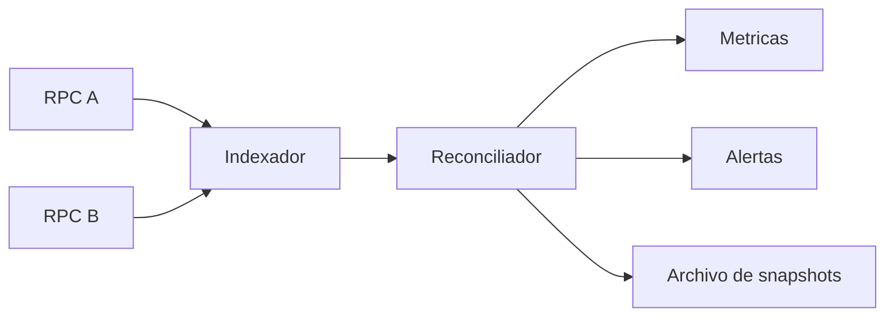
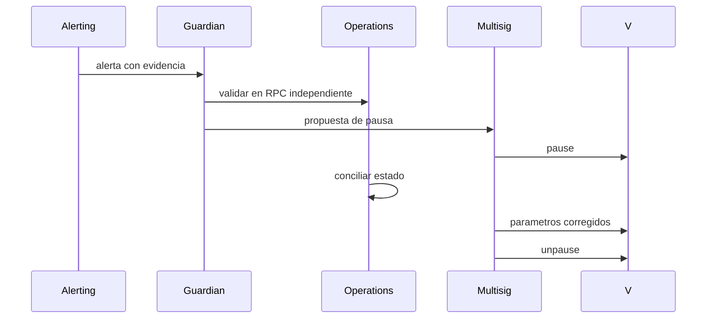

# Operacion y observabilidad

## Cadencia

| Frecuencia      | Control                                      |
| --------------- | -------------------------------------------- |
| Cada bloque     | Pausas, depósitos y retiradas relevantes     |
| 5 minutos       | Idle, deuda, capacidad de retirada y caps    |
| Cada checkpoint | Cambio estimado, liquidez y digest de riesgo |
| Diario          | Roles, treasury, cola y concentracion        |
| Por release     | Bytecode, parametros, referencias y runbooks |

## Pipeline de observabilidad

Una alerta debe contener bloque, chain id, vault, estrategia, valor observado, umbral, transaccion
causal y digest del snapshot.

## Señales prioritarias

- liquidez de salida inferior a demanda prevista;
- reporte fuera de ventana;
- cambio de estimacion cerca del limite;
- concentracion por estrategia o bucket;
- perdida realizada durante recuperacion;
- cap global o individual consumido;
- cambio de roles, owner, treasury o cola;
- pausa y reanudacion.

## Contencion

No se debe reanudar hasta que la suite de invariantes, la conciliacion y las metricas de cobertura
resulten satisfactorias.

## Release

El commit aprobado debe coincidir en `main`, `production` y el tag. Archiva salidas de CI, bytecode,
tamaños, hashes de banner y parametros aprobados.
