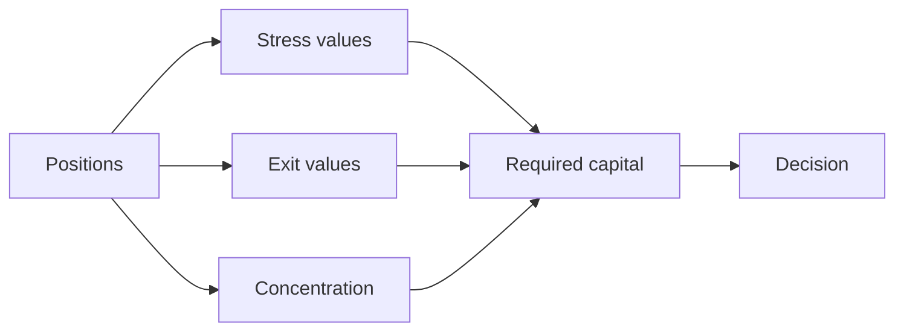
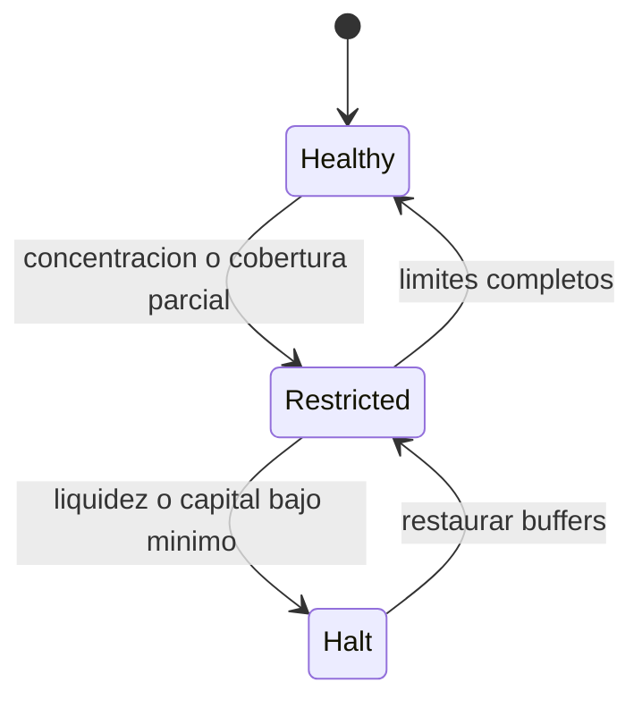

# Riesgo y suficiencia de capital

## Snapshot

El motor recibe un conjunto maximo de 16 posiciones. Cada `strategyId` es unico y cada posicion
activa declara estimacion, liquidez, shock, descuento de salida y bucket de correlacion.



## Stress y salida

```text
stressed_i = estimated_i * (10_000 - lossBps_i) / 10_000
exit_i     = liquid_i * (10_000 - discountBps_i) / 10_000
```

La perdida esperada de stress es la diferencia entre estimacion y valor bajo stress. La brecha de
liquidez compara demanda con idle mas salidas descontadas.

## Concentracion

El HHI se calcula sobre pesos por estrategia:

```text
weight_i = estimated_i / totalEstimated
HHI = sum(weight_i^2)
```

Ademas se miden la mayor estrategia y el mayor bucket. El exceso sobre cada limite se incorpora como
add-on de capital, de modo que concentraciones correlacionadas no queden ocultas por un numero
elevado de adaptadores.

## Decision



`Healthy` permite operacion ordinaria. `Restricted` requiere reducir riesgo o limitar nuevas
asignaciones. `Halt` recomienda detener admisiones hasta restaurar cobertura. La ejecucion de esa
politica corresponde al sistema operativo, no al motor puro.

## Ejemplo severo

Si la salida descontada es `620.000` y la demanda `750.000`, la brecha es `130.000`. Con perdida de
stress `110.000` y buffer `50.000`, el capital base requerido alcanza `290.000` antes de add-ons. Un
capital de `250.000` cubre aproximadamente `8.620 bps`, por debajo de una politica de `9.000 bps`.

## Uso operativo

- fijar shocks por clase de estrategia;
- separar buckets por fuente de riesgo comun;
- recalcular tras reportes, caps o cambios de cola;
- persistir `snapshotDigest` junto al bloque y parametros;
- no mezclar snapshots de bloques diferentes;
- tratar la decision como una señal adicional, no como unica autorizacion.
